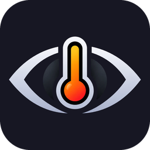
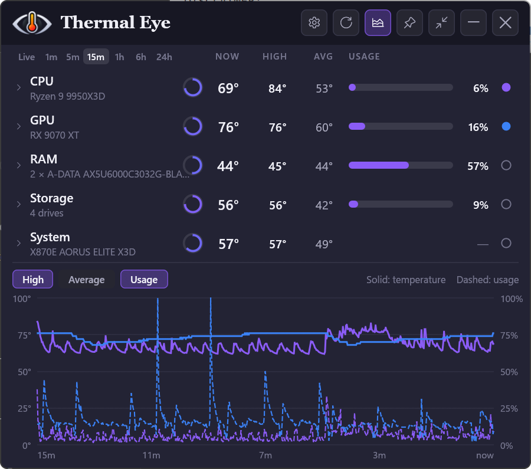
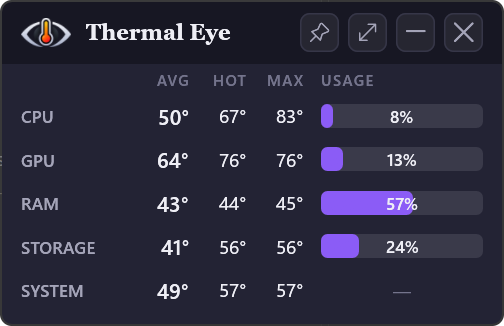
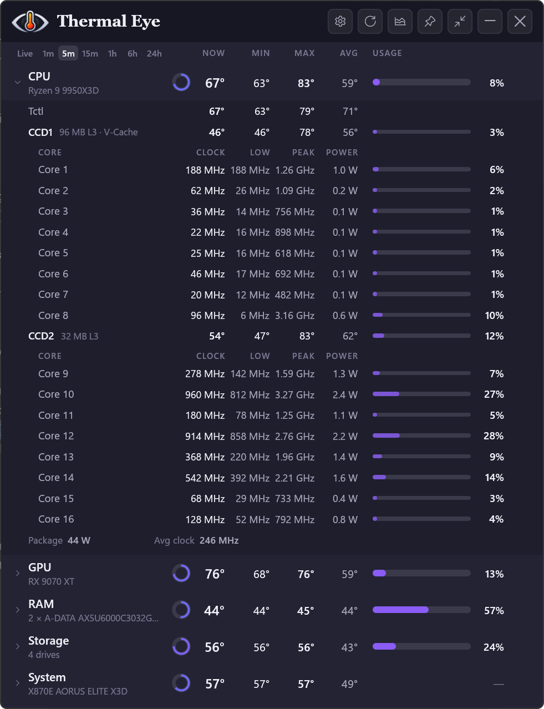

  

<h1 align="center">Thermal Eye</h1>

  A small, modern temperature monitor for Windows. 
  CPU, GPU, RAM, drives and motherboard at a glance, in one tidy widget.

  <a href="https://github.com/H3katonkheir/thermal-eye/releases/latest"><strong>Download the latest version</strong></a>

  

## What it does

- **Every component in one place:** current, min, max and average temperature, plus
  average usage, for your CPU, graphics card, RAM, drives and motherboard.
- **History graph:** use the dot at the end of a row to plot it, from whole components
  down to a single core or sensor, over anything from the last minute to the last 24 hours.
- **Every core:** open the CPU row to see each core's clock, low, peak, power and usage,
  grouped by die.
- **Compact view:** a small window that stays out of the way, and can stay on top.
- **In the tray:** the hottest reading sits by the clock, coloured the same way, with
  every component in its tooltip. Click it to bring the window back. Windows hides new
  tray icons at first, so look under **^**, and drag it out to keep it in view. Turn it
  off with **Temperature in tray** in Settings. With **Close to tray** on, the close
  button hides the window instead, and **Exit** in the icon's menu quits.
- **Warnings at a glance:** readings turn amber or red as they near each part's limits.
  Hover over a component's ring to see where those limits are.
- **Updates itself:** one click to install a new version.

  
  &nbsp;&nbsp;
  

## Installing

1. [Download `ThermalEyeSetup`](https://github.com/H3katonkheir/thermal-eye/releases/latest)
   from the latest release and run it.
2. If Windows says it protected your PC, choose **More info**, then **Run anyway**.
   See [Code signing policy](#code-signing-policy) for why.
3. Approve the permission prompt. It won't ask again, including at sign-in.

You need 64-bit Windows 11. Windows 10 should work too, with square corners. There is
nothing else to install first.

> [!WARNING]
> **FACEIT players:** temperatures for the CPU, RAM and motherboard come through a
> driver called [PawnIO](https://pawnio.eu), which the FACEIT anti-cheat blocks. Setup
> offers it as an option, so leave it unticked. You will still see GPU and drive
> temperatures, and usage for everything.

To remove Thermal Eye, use **Installed apps** in Windows Settings. PawnIO stays behind
in case other apps use it, and can be removed the same way.

## Reading the numbers

| Column | Meaning |
| --- | --- |
| **Now** | The hottest of the component's sensors right now |
| **Min** | The lowest Now got during the selected span |
| **Max** | The hottest any of its sensors got during the selected span |
| **Avg** | The mean of its sensors over the selected span |
| **Usage** | Mean usage over the selected span |

The span selector, from Live to 24h, controls these figures and the graph together.
Live has no span, so it leaves out Min and Max. To save room, either can be hidden
under **Show columns** in Settings, and the window narrows to match.
History is kept in memory, so it starts again when the app closes.

- **CPU temperature:** Max includes Tctl, the value your fans follow. Avg uses only
  the die sensors, because Tctl can read well above them.
- **Core temperature:** Ryzen CPUs report temperature per die rather than per core, so
  it appears on the CCD rows, and core rows show clock, power and usage instead.
- **Clock speeds:** these are effective clocks, so idle cores read in MHz.
- **Core usage:** the mean of the core's two threads, so one busy thread reads about 50%.
- **Motherboard sensors:** the CPU socket sensor is listed, but left out of the System
  figures so that row doesn't just repeat the CPU. Boards the app has no labels for
  show generic names such as `Temperature 1`.
- **Fans:** headers reading 0 RPM are hidden, since most have nothing plugged in.

## Updates

Thermal Eye looks for a new version at launch and once a day. New versions download in
the background, then a banner offers **Install**. That takes one permission prompt, and
the widget reopens by itself. **What's new** then shows what changed. Your settings are
kept. To stop checking, turn off **Check for updates** in Settings.

Every update is signed, and the app refuses anything without a valid signature.

## Something not working?

Open Settings (the gear icon), click **Copy details** next to **Diagnostics**, and paste
it into a [new issue](https://github.com/H3katonkheir/thermal-eye/issues/new), along with
what you expected to see.

It lists your hardware, its current readings and recent log messages, so you can read it
first. Your username and PC name are removed, and drive serial numbers are never
collected. The full log is at `%LOCALAPPDATA%\ThermalEye\thermal-eye.log`.

## Privacy

Thermal Eye has no accounts, analytics or tracking, and sends no sensor data anywhere.

It connects to one service by itself: [GitHub](https://github.com), to check for and
download updates, covered by the
[GitHub privacy statement](https://docs.github.com/site-policy/privacy-policies/github-general-privacy-statement).
Turn off **Check for updates** in Settings and it connects to nothing. **What's new**,
**Get PawnIO** and PawnIO's optional download in setup only happen when you choose them.

Settings and the log stay on your PC. Diagnostics only leave it if you paste them
somewhere yourself.

## Code signing policy

Thermal Eye's installer is not code-signed yet, which is why Windows may warn you about
it. That is separate from the update signature described above, which every update has.

The project plans to sign releases, and this policy applies when it does:

- Signed files are built from this repository by [GitHub Actions](.github/workflows/build.yml),
  never on a personal machine.
- Only files built from this project's own source, and the open-source components in
  [THIRD-PARTY-NOTICES.md](THIRD-PARTY-NOTICES.md), are signed.
- Every signing request is approved by hand.

| Role | Who |
| --- | --- |
| Committers and reviewers | [H3katonkheir](https://github.com/H3katonkheir) |
| Approvers | [H3katonkheir](https://github.com/H3katonkheir) |

## Credits and licence

Thermal Eye is [MIT licensed](LICENSE). Hardware access uses
[LibreHardwareMonitor](https://github.com/LibreHardwareMonitor/LibreHardwareMonitor) and
[PawnIO](https://pawnio.eu). See [THIRD-PARTY-NOTICES.md](THIRD-PARTY-NOTICES.md) for
everything it builds on.

Want to build it yourself or help out? See [docs/DEVELOPMENT.md](docs/DEVELOPMENT.md).
